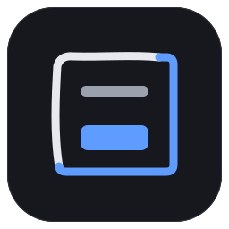
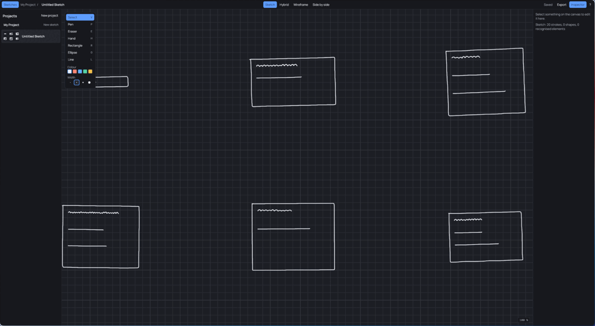

<p align="center">
  
</p>

<h1 align="center">NeuralCanvas for Linux</h1>



<p align="center">
  <strong>A GPU-accelerated sketch-to-wireframe canvas for Linux (Arch + Wayland/Hyprland).</strong><br>
  Freehand sketches to clean, aligned wireframes with instant style mirroring and vector export.
</p>

<p align="center">
  
  
  
  
  
</p>

<p align="center">
  <a href="https://github.com/nodaysidle/neural-canvas/releases/download/v0.1.0/NeuralCanvas-0.1.0-x86_64.AppImage"><strong>Download Linux AppImage (v0.1.0)</strong></a>
  ·
  <a href="https://github.com/nodaysidle/neural-canvas/releases">All Releases</a>
</p>

<p align="center">
  <a href="#core-capabilities">Features</a> ·
  <a href="#measured-performance">Performance</a> ·
  <a href="#keyboard-shortcuts">Shortcuts</a> ·
  <a href="#installation">Install</a> ·
  <a href="#repository-architecture">Architecture</a>
</p>

---

## Core capabilities

- **Infinite GPU canvas.** Instanced SDF capsule strokes with analytic anti-aliasing at every angle. 1€ filter
  smoothing plus one-frame predictive ink keeps the pen tip within 1.3 px (p95) of the pointer. Steady 120 fps at
  1440p on an Intel Arc iGPU.
- **Local heuristic recognition.** 96.7 % accuracy on held-out stroke fixtures. Recognises 15 shape types (buttons,
  inputs, cards, containers, dividers, icons, images, text and geometric primitives) on a worker thread in about
  55 ms, without blocking the canvas.
- **Interactive wireframe overlay.** Cycle raw sketch, hybrid and clean wireframe (`W`), set opacity (`[` / `]`),
  compare side by side (`Shift+W`), and step through low-confidence items (`U`).
- **Style mirror.** Import an app screenshot. NeuralCanvas extracts the palette with K-Means clustering, estimates
  corner radii and spacing, checks WCAG 2.1 AA contrast and applies the result to the wireframe.
- **Export pipeline.** SVG, PDF (`svg2pdf`), PNG (2×) and JPEG, for both the raw sketch and the wireframe.
- **Local-first and private.** No cloud, no accounts, no telemetry. SQLite (WAL) storage with a 300 ms debounce,
  flushed on sketch switch, window close and SIGTERM.

## Measured performance

Reference machine: Intel Core Ultra (Meteor Lake), Intel Arc iGPU, Mesa 26.2.5, 2560×1440 @ 120 Hz, Hyprland.
Scene: 2,000 strokes / 200k points. Release build.

| Metric | Result | Budget |
|---|---|---|
| p99 frame interval (draw / pan / zoom) | 8.34 ms | ≤ 8.3 ms at 120 Hz refresh |
| Frames over 16.6 ms | 0 | 0 |
| CPU cost per input sample | 48 ns | < 1 µs |
| Cold start to first frame | 111 ms | ≤ 300 ms |
| RSS, idle | 68 MB | ≤ 80 MB |
| AppImage size | 9.67 MB | ≤ 40 MB |
| Idle | 0 scheduled frames, 0 CPU ticks | ~0 % CPU |

The 8.34 ms p99 is one refresh interval at 120 Hz (8.33 ms): frames are paced by vsync, not by work.
Input-to-photon latency is 22.7 ms p95 measured from pointer event to scanout; with predicted ink the derived
figure is about 14 ms p95. No 240 fps camera run has confirmed it yet. Method, raw numbers and open risks are in
[`docs/reports/`](docs/reports/).

## Keyboard shortcuts

| Key | Action |
|---|---|
| `P` | Pen |
| `E` | Eraser |
| `H` | Hand |
| `Space` (hold) | Temporary hand; the previous tool returns on release |
| `V` | Select |
| `R` / `O` / `L` | Rectangle / Ellipse / Line |
| `W` | Cycle sketch, hybrid, wireframe |
| `Shift+W` | Side-by-side view |
| `[` / `]` | Wireframe opacity |
| `U` | Review uncertain items |
| `Ctrl+Z` / `Ctrl+Shift+Z` | Undo / Redo |
| `Ctrl+0` | Fit to content |
| `Ctrl+1` | Zoom to 100 % |
| `Ctrl+E` / `Ctrl+Shift+E` | Export (all formats to `~/Pictures/NeuralCanvas/`) |
| `Ctrl+B` / `Ctrl+I` | Toggle sidebar / inspector |
| `Ctrl+?` | Shortcuts overlay |

## Installation

### AppImage

Download `NeuralCanvas-0.1.0-x86_64.AppImage` (9.67 MB) and its `.sha256` from the
[releases page](https://github.com/nodaysidle/neural-canvas/releases), then verify and run:

```sh
sha256sum -c NeuralCanvas-0.1.0-x86_64.AppImage.sha256
chmod +x NeuralCanvas-0.1.0-x86_64.AppImage
./NeuralCanvas-0.1.0-x86_64.AppImage
```

The AppImage uses your system's Wayland library and GPU driver, so you need a working Vulkan driver.

### Arch Linux

Build from source with `packaging/arch/PKGBUILD`, or install the prebuilt binary with `packaging/arch/PKGBUILD-bin`:

```sh
cd packaging/arch
makepkg -si -p PKGBUILD        # or: makepkg -si -p PKGBUILD-bin
```

### Build from source

Needs Rust ≥ 1.89 and a Vulkan driver.

```sh
sudo pacman -S --needed rust vulkan-icd-loader vulkan-intel   # or vulkan-radeon / nvidia-utils
cargo run --release -p neuralcanvas
```

Checks: `cargo fmt --check && cargo clippy --workspace --all-targets -- -D warnings && cargo test --workspace`.

## Repository architecture

| Crate | Role |
|---|---|
| `nc-core` | Document model, commands and undo, stroke geometry, viewport maths, recognition, style mirror. No GPU, no window. |
| `nc-render` | wgpu renderer: grid, instanced SDF strokes, wireframe overlay, UI pass. Tested offscreen. |
| `nc-store` | SQLite (WAL) persistence on its own thread: one row per element, schema migrations. |
| `nc-export` | SVG writer (single source of truth), PDF via `svg2pdf`, PNG and JPEG via `resvg`. |
| `nc-shell` | Shell layout and all UI copy: bar, palette, sidebar, inspector, toasts, dialogs. Emits a scene and accessibility regions. |
| `nc-wayland` | Side channel on winit's Wayland display: presentation feedback and tablet (pressure, tilt, eraser) input. |
| `nc-app` | The `neuralcanvas` binary: window, input, actions, workers. |

`nc-bench` (measurement harness) and `spike-iced` (shell spike) are development-only and never packaged.
Design decisions live in [`docs/PLAN.md`](docs/PLAN.md); budgets in
[`docs/PERFORMANCE-BUDGET.md`](docs/PERFORMANCE-BUDGET.md).

## License

MIT. Bundled fonts (Manrope, DM Mono) are SIL OFL; their texts ship next to [`LICENSE`](LICENSE).
